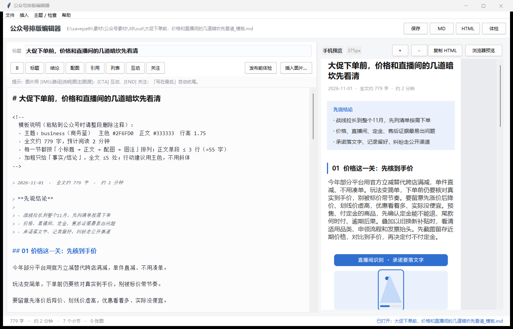

# wechat-md · 公众号排版工具

把「文案 + 图片」变成公众号能直接用的排版：离线生成 Markdown 模板和可粘贴 HTML，带桌面编辑器、格式校验和 AI 提示词。



## 它解决什么问题

公众号后台的编辑器只能一段段调样式，长文排版有三个麻烦：

1. **样式不统一**——今天 16px、明天 17px，小标题一会儿加粗一会儿变色；
2. **图片和图注散架**——复制来复制去，图注经常和图对不上；
3. **改一遍要重排一遍**——从 Word、网页、AI 复制过来的内容，格式全得重来。

这个工具把排版规则固化成一套模板：你只管写文案，编号、间距、图注、结尾三件套由程序统一生成。

## 功能

- **三种输出**：Markdown 模板（可继续改）、内联样式 HTML（浏览器全选复制 → 后台粘贴）、手机宽度预览页
- **多格式输入**：`.md` `.txt`（自动识别 GBK/BOM）、`.html`（含公众号文章页，自动过滤导航/工具条/隐藏块）、`.docx`（图片自动抽出）
- **桌面编辑器**（Tk，标准库）：左边写稿、右边实时手机预览、工具条插组件、发布前体检
- **三套主题**：商务蓝 / 新闻红 / 暖橙，字距、标题样式、代码配色随主题变
- **发布前体检**：标题长度、结论卡、编号重复、图片路径、图注缺失、段落过长、分隔线过多、结尾组件
- **AI 提示词**：`prompts/` 里是对大模型写的格式约束，生成结果可直接导入
- **零依赖**：只用 Python 标准库（GUI 的 JPG 预览可选 Pillow）

## 快速开始

需要 Python 3.8+。

```bash
git clone <本仓库地址>
cd wechat-md

# 命令行：文案 → 模板
python tools/wechat_md.py examples/bear.md -o 输出.md --html 输出.html

# 查看支持的输入格式
python tools/wechat_md.py --list-formats

# 直接吃网页 / Word
python tools/wechat_md.py 文章.html -o 输出.md
python tools/wechat_md.py 稿子.docx -o 输出.md --summary

# 桌面编辑器（Windows 也可双击 wechat_md_gui.bat）
python tools/wechat_md_gui.py examples/bear.md
```

Windows 下也可以把文件拖到 `wechat_md.bat` 上。

## 文案怎么写

```markdown
# 标题（20–30 字）

## 先说结论

> · 结论一（≤24 字）
> · 结论二
> · 结论三（给一个可执行动作）

导语一到两句话。

## 01 小节标题

正文一段一行，段间空行，单段 ≤55 字。关键事实可以 **加粗**。

[IMG:imgs/01.jpg|画面描述|图注：说明。图源：某处]

- 列表会排成 ①②③
- 不会嵌套

> 引用块放专家原话或金句。

## 02 另一个小节

```python
# 围栏代码块会渲染成深色块
print("hello")
```

## 写在最后

一句收束全文的话。

[CTA]
一句互动提问。

[END]
**关注「公众号名称」，每天一个新鲜事。**
```

完整语法见 [`tools/README.md`](tools/README.md)，可复制模板见 [`templates/wechat-template.html`](templates/wechat-template.html)。

## 三种产物怎么用

| 产物 | 用途 |
| --- | --- |
| `*_模板.md` | 继续改文案；带模板说明、参数表、发布前自检清单 |
| `*_可粘贴.html` | 浏览器打开 → `Ctrl+A` 复制 → 公众号后台正文粘贴（图片在后台重新上传） |
| `--preview` 预览页 | 发之前看手机效果 |

## 桌面编辑器

`python tools/wechat_md_gui.py` 或双击 `wechat_md_gui.bat`。

- 左边写稿，右边实时手机预览（375px，可缩放）；
- 工具条一键插：小标题、结论卡、配图、引用、列表、互动、关注；
- 配图对话框支持「复制到 imgs/」，图片不乱丢；
- `Ctrl+K` 发布前体检，点条目直接跳到对应行；
- 支持打开 md / txt / html / docx，保存默认另存为 `.md`，不覆盖原文件。

## 项目结构

```
tools/
  wechat_md.py          命令行主程序：解析 → 渲染 Markdown / HTML
  convert.py            HTML / DOCX / GBK 文本 → Article
  wechat_md_gui.py      桌面编辑器（Tk）
  gui_core.py           编辑器核心逻辑（无界面，可单测）
  check_prompt_output.py 校验 AI 生成的文案格式
  make_demo.py          生成 examples/ 里的演示素材
prompts/                给大模型的提示词（完整版 + 精简版）
examples/               各格式输入样例与生成结果
templates/              可粘贴的 HTML 排版模板
docs/                   设计说明：排版规范、预览实现、插件参考、模板对比
tests/                  70 项回归测试
```

## 测试

```bash
python -m unittest discover -s tests -v
python tools/wechat_md_gui.py --selftest   # 无窗口跑一遍编辑器链路
```

覆盖：模板解析与渲染、多格式转换（HTML/公众号页/GBK/DOCX）、模板往返、提示词校验、编辑器核心。

## 设计说明

- [排版规范与诊断](docs/format-guideline.md)：字号、行高、间距、图注、结尾的取值依据
- [预览渲染实现](docs/preview-rendering.md)：为什么用 Canvas + 固定页宽
- [参考插件改造](docs/plugin-reference.md)：吸收了哪些排版细节、哪些没做
- [模板对比](docs/template-diff.md)：生成物再编辑时容易踩的坑

## 已知限制

- 公众号后台会过滤外链图片，HTML 里的本地图片路径需要重新上传；
- `.doc`（旧版 Word）不支持，请先另存为 `.docx`；
- 预览是模拟渲染，最终效果以后台保存后的手机预览为准；
- 只处理排版，不做 AI 写作（配了提示词，但模型调用在你自己的工具里）。

## License

MIT，见 [LICENSE](LICENSE)。
